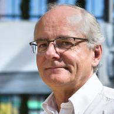
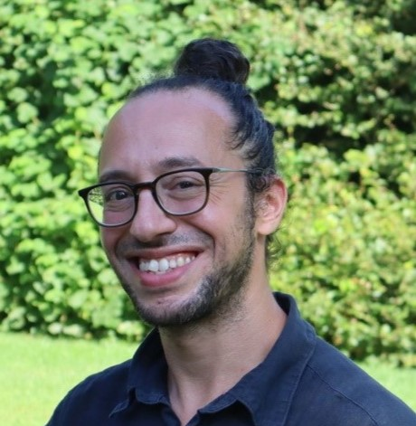
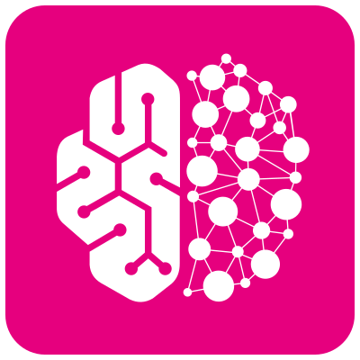

---
myst:
    html_meta: {
        "description lang=en": "Victor Férat, research engineer and data steward at Campus Biotech, Geneva. Reproducible neuroimaging pipelines, open-source toolboxes, and neuroimaging tutorials.",
        "keywords": "Neuroimaging, Portfolio, eeg, fmri, meg, dev",
        "property=og:locale": "en_US"
    }
---

# Victor Férat

::::{grid} 1 1 2 2
:gutter: 4

:::{grid-item}
:columns: 12 12 9 9
I'm really glad you're here. I'm a software engineer and neuroscience researcher, and these days you'll find me at the [M/EEG & Neuromod (MEG) Platform](https://campus-neuro.ch/en/meg/) of Campus Biotech in Geneva, where I work as a research engineer.

My job is to help researchers get their studies done. When someone comes to us with a project, I help them figure out which equipment suits their question and how to get the most out of it. Together with my team, I look after the MEG, EEG, and neuromodulation equipment, and we build tools that make life a little easier for the researchers we work with. And when a research group needs our expertise, we can also step in as consultants: we acquire the data, preprocess it, and analyze it for them.

I'm also passionate about open source, and this site is where I share that side of my work. You'll find the projects I've been involved in, from research work to robust frameworks. I care a lot about clean code, efficiency, and the small details, and I hope that shows in each of them.

Whether you're a fellow enthusiast, a potential collaborator, or an employer, I hope this gives you a good sense of what I do. I'd love to connect!

Victor
:::

:::{grid-item}
:columns: 12 12 3 3
```{image} _static/images/meg-triux-neo.jpg
:alt: The MEGIN TRIUX neo MEG scanner in its shielded room at Campus Biotech
:class: vf-position-photo dark-light
```

```{container} vf-position-credit
The platform's MEGIN TRIUX neo MEG. © Campus Biotech Geneva Foundation.
```
:::
::::

## What I work on

::::{grid} 1 1 2 2
:gutter: 3

:::{grid-item-card} EEG neurofeedback
Using EEG, the most affordable neuroimaging method, to develop neurofeedback interventions that could benefit both clinical and non-clinical populations.
:::

:::{grid-item-card} Reproducible neuroimaging pipelines
Building robust analysis pipelines to ensure reproducibility and scalability in neuroimaging research.
:::
::::

## Projects

::::{grid} 1 1 2 2
:gutter: 3

:::{grid-item-card} Pycrostates
:link: posts/2020/2020-11-04
:link-type: doc

{modality}`eeg`

An open-source Python package for analyzing EEG microstates, designed to work with MNE-Python.
:::

:::{grid-item-card} GEDAI
:link: posts/2025/2025-10-13
:link-type: doc

{modality}`eeg`

An open-source Python package for unsupervised EEG denoising based on leadfield filtering.
:::

:::{grid-item-card} MEEG Pipelines
:link: posts/2026/2026-09-07
:link-type: doc

{modality}`meg`

A BIDS app, currently under construction, that automatically prepares MEG and anatomical data for MEG source reconstruction.
:::

:::{grid-item-card} Pycartool
:link: posts/2019/2019-07-18
:link-type: doc

{modality}`eeg`

A simple open-source Python package that provides I/O for most Cartool file formats, as well as additional computing features.
:::

:::{grid-item-card} Blender Brain Atlas
:link: posts/2021/2021-11-27
:link-type: doc

A script that creates 3D objects from an MRI segmentation file, with one object for each brain region of interest.
:::

:::{grid-item-card} Personalized tACS Pipeline
:link: posts/2024/2024-05-01
:link-type: doc

{modality}`eeg` {modality}`neuromod`

A pipeline that turns T1 MRI and EEG data into personalized brain stimulation parameters for the next day.
:::
::::

## Contributions

```{container} vf-contrib
- [MNE-Python](https://github.com/mne-tools/mne-python)
- [Nipype](https://github.com/nipy/nipype)
- [MRIQC](https://github.com/nipreps/mriqc)
- [MNE-BIDS-Pipeline](https://github.com/mne-tools/mne-bids-pipeline)
- [MNELAB](https://github.com/cbrnr/mnelab)
```

## I work[ed] for them:

```{raw} html
<ul class="vf-people">
  <li><a href="https://nccr-synapsy.ch/news/aw-team-member/christoph-michel/"><span>Christoph Michel</span></a></li>
  <li><a href="https://www.tomasros.com/"><span>Tomas Ros</span></a></li>
  <li><a href="https://neuroling.github.io/index.html"><span>Alexis Hervais-Adelman</span></a></li>
  <li><a href="https://neurocenter-unige.ch/research-groups/sophie-schwartz/"><span>Sophie Schwartz</span></a></li>
  <li><a href="https://neurocenter-unige.ch/research-groups/patrik-vuilleumier/"><span>Patrik Vuilleumier</span></a></li>
  <li><a href="https://neurocenter-unige.ch/research-groups/lucie-brechet/"><span>Lucie Bréchet</span></a></li>
  <li><a href="https://neurocenter-unige.ch/research-groups/nicolas-burra/"><span>Nicolas Burra</span></a></li>
  <li><a href="https://allhere.org/"><span>All Here</span></a></li>
  <li><a href="https://campus-neuro.ch/en/meg/"><span>M/EEG &amp; Neuromod Platform</span></a></li>
  <li><a href="https://bioserenity.ai/"><span>BioSerenity</span></a></li>
</ul>
```

## Latest posts

```{postlist} 3
:date: "%B %Y"
:format: "{title} ({date})"
```

## Open-source badges

[](https://holopin.io/@vferat)

```{toctree}
:maxdepth: 2
:hidden:
about
projects/index
publications
blog
```
